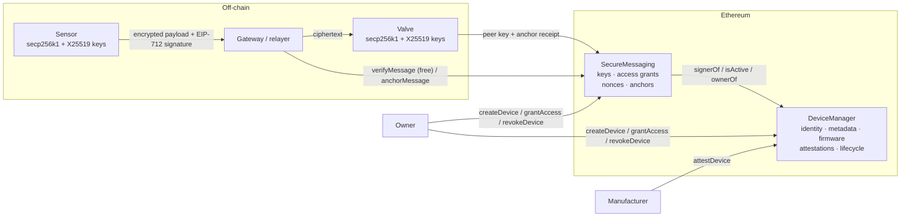

# Securing IoT Device Communication with Blockchain

An Ethereum-based trust layer for IoT. Devices get an on-chain identity. Manufacturers and auditors attest to their firmware. Devices then exchange **end-to-end encrypted, signed and replay-protected messages** over untrusted gateways.

Started in 2022 as a university research prototype (Solidity 0.5, see [`legacy/v0.5`](legacy/v0.5)). It was later rewritten as a tested Hardhat project on Solidity 0.8 and OpenZeppelin 5.

```
$ npm run simulate
== 6. Secure message: sensor -> valve ==
  ✔ Gateway verdict: Valid — message anchored, nonce now 1
  ✔ Valve decrypted: {"temperature":17.2,"unit":"C","ts":...}
== 7. Attacks ==
  ✘ Replay of the same packet -> InvalidNonce
  ✘ Payload modified in transit -> InvalidSignature
  ✘ Attacker-signed message claiming to be the sensor -> InvalidSignature
  ✘ Unauthorised rogue device #2 -> NotAuthorized
  ✘ Attacker granting itself access -> NotDeviceOwner
  ✘ Firmware report with backdoor matches registry: false
  ✘ Sensor revoked by owner, next message -> SenderInactive
```

## Why

IoT networks usually rely on a central server to know which devices are genuine and which keys belong to them. That server is a single point of failure and a high-value target. This project moves that knowledge to a public, tamper-evident ledger:

- **Identity**: each device is registered with its public key (as an Ethereum address), a Merkle root of its metadata and a commitment to its firmware.
- **Trust**: third parties attest devices. An attestation is bound to the exact device state, so a firmware update invalidates it until the device is re-attested.
- **Secure channels**: devices publish X25519 keys on-chain, derive shared secrets (ECDH) and encrypt payloads with AES-256-GCM. Only hashes go on-chain.
- **Authorisation and replay protection**: device owners decide who can talk to their devices. Every message carries an EIP-712 signature from the device key, a nonce and a deadline.

## Architecture



| Contract | Responsibility |
|---|---|
| [`DeviceManager`](contracts/DeviceManager.sol) | Composes the core modules below |
| [`core/EntityRegistry`](contracts/core/EntityRegistry.sol) | Public profile data for manufacturers, owners and auditors |
| [`core/DeviceRegistry`](contracts/core/DeviceRegistry.sol) | Device storage, unique identifiers, Merkle metadata proofs, firmware checks, EIP-191 signature checks |
| [`core/DeviceAttestations`](contracts/core/DeviceAttestations.sol) | Expiring, revocable third-party attestations bound to device state |
| [`core/DeviceLifecycle`](contracts/core/DeviceLifecycle.sol) | Transfer, key rotation, firmware/metadata updates, suspend / reactivate / revoke |
| [`SecureMessaging`](contracts/SecureMessaging.sol) | Encryption key directory, access grants, EIP-712 message verification and anchoring |

## Threat model

| Threat | Mitigation |
|---|---|
| Eavesdropping on the network or gateway | AES-256-GCM with keys derived via X25519 ECDH + HKDF. Ciphertext only, never on-chain |
| Man-in-the-middle swaps public keys | Encryption keys are published on-chain by the device owner or device key |
| Message tampering | Device signs `keccak256(ciphertext)` with EIP-712, and GCM authenticates the ciphertext |
| Device impersonation | Signature must recover to the device key registered in `DeviceManager` |
| Replay | Per-sender sequential nonce, consumed by `anchorMessage`, plus a deadline |
| Cross-chain / cross-deployment replay | EIP-712 domain separator includes chain ID and contract address |
| Unauthorised device sends commands | Receiver owner must `grantAccess`, and grants expire |
| Malicious firmware | Firmware commitments are on-chain and attestations break when firmware changes |
| Compromised device key | Owner can `suspendDevice` or permanently `revokeDevice`. The key can never be re-registered |
| Signature malleability | OpenZeppelin `ECDSA.tryRecover` rejects high-`s` signatures |

## Quick start

Requirements: Node.js 20+ (CI uses 22).

```bash
npm install
npm test             # 38 unit tests
npm run coverage     # 100% line coverage
npm run simulate     # end-to-end IoT scenario with attacks
npm run lint         # solhint
npm run gas          # gas usage report
```

Deploy to a local node:

```bash
npm run node                 # terminal 1
npm run deploy:local         # terminal 2, writes deployments/localhost.json
```

To deploy to Sepolia, copy `.env.example`, export `SEPOLIA_RPC_URL` and `DEPLOYER_PRIVATE_KEY`, and run `npx hardhat run scripts/deploy.js --network sepolia`.

## Message flow

1. **Onboarding**: the owner calls `createDevice(identifier, metadataRoot, firmwareCommitment)`. The identifier is the device's Ethereum address, left-padded to 32 bytes.
2. **Attestation**: the manufacturer calls `attestDevice(id, expiry)`. `isTrusted(id)` becomes `true`.
3. **Key exchange**: each device calls `publishEncryptionKey(id, x25519PublicKey)`.
4. **Authorisation**: the receiver's owner calls `grantAccess(receiverId, senderId, expiresAt)`.
5. **Send**: the sender encrypts the payload for the receiver, then signs `DeviceMessage{senderId, receiverId, payloadHash, nonce, deadline}`.
6. **Relay**: the gateway calls `verifyMessage(...)` (a free view call that returns a `Verdict`). It then optionally calls `anchorMessage(...)`, which consumes the nonce and records a receipt.
7. **Receive**: the receiver checks `anchoredAt(digest)`, fetches the sender's key and decrypts.

Off-chain helpers live in [`lib/`](lib): `merkle.js` (metadata trees and proofs), `eip712.js` (typed-data signing) and `crypto.js` (ECDH + AES-GCM).

## What changed from the 2022 prototype

| Area | v0.5 prototype | v2 |
|---|---|---|
| Compiler | Solidity 0.5, hand-copied libraries | Solidity 0.8.24, OpenZeppelin 5 (`ECDSA`, `MerkleProof`, `EIP712`, `EnumerableSet`) |
| Signature check | Raw `ecrecover` on an unprefixed hash, malleable | EIP-191 prefix, malleability-safe `tryRecover` |
| Identifiers | Not unique | Enforced unique and never reusable after rotation |
| Signatures / attestations | Anyone (including the owner) could sign any ID, even non-existent ones, with expiry in the past. Expiry was never checked. A signed device stayed locked until every signer revoked | Attestations need an active device and a third party with a future expiry. They expire, can be revoked, and are invalidated automatically by firmware or metadata changes |
| Ownership | Transfer to `address(0)` possible | Zero/self transfers rejected; O(1) per-owner indexing |
| Lifecycle | none | Suspend / reactivate / revoke |
| Device-to-device messaging | none | `SecureMessaging`: key directory, access grants, EIP-712, nonces, deadlines, anchoring |
| Errors | Revert strings or panics | Custom errors with context |
| Tooling | none | Hardhat, 38 tests, coverage, solhint, GitHub Actions, simulator |

## Limitations and future work

- `getActiveAttestationsForDevice` loops over a device's attestation history. That is fine for view calls, but it should be paginated if a device collects hundreds of attestations.
- Anchoring every message on L1 is expensive. In production, anchor batches (Merkle root of many message digests) or deploy on an L2.
- Constrained microcontrollers may not support secp256k1. A gateway could co-sign on their behalf, or support for P-256 (RIP-7212) could be added.
- Access grants are per device pair. Role or group based policies would scale better.

## Project structure

```
contracts/
  DeviceManager.sol          # deployable registry
  SecureMessaging.sol        # deployable messaging layer
  core/                      # registry modules
  interfaces/IDeviceRegistry.sol
lib/                         # off-chain helpers (Merkle, EIP-712, crypto)
scripts/deploy.js
scripts/simulate.js
test/                        # Hardhat + chai tests
legacy/v0.5/                 # original 2022 prototype
```

## License

MIT
